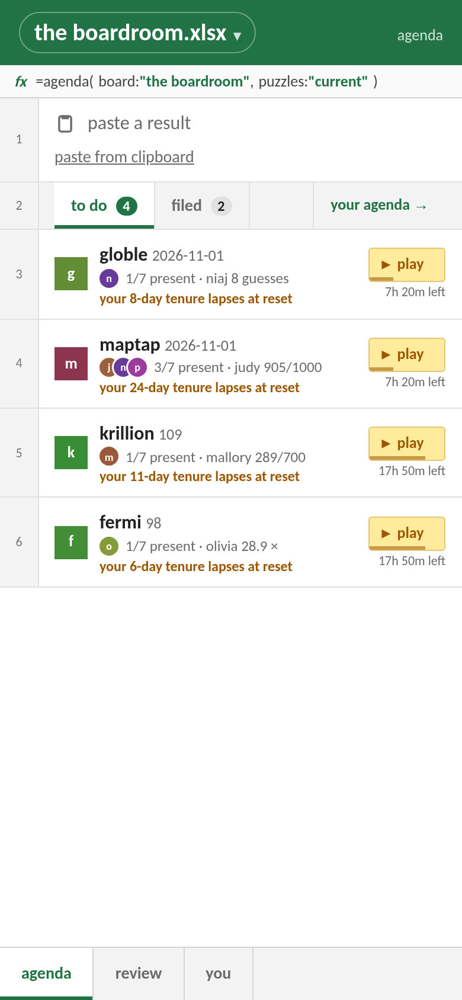
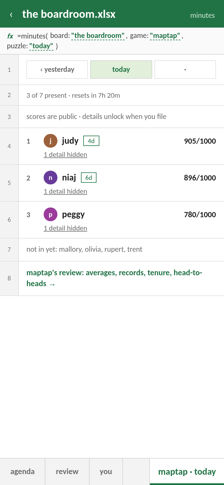
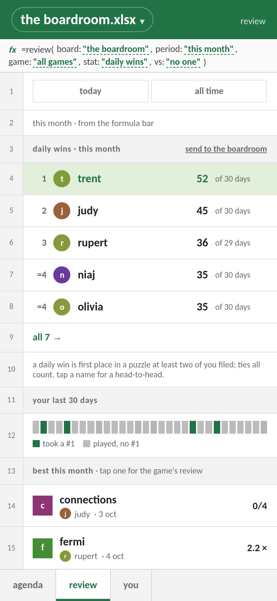

# boredroom.xlsx

**A leaderboard for the daily puzzles your group chat already argues about.**

Wordle, Connections, MapTap, Krillion, Fermi and the long tail of obscure ones. Paste
the share text the game gives you; boredroom files it, ranks the table, and keeps the
minutes. Streaks become *tenure*, the person who started it all is *the chair*, and every
screen is a spreadsheet, because this is a board meeting and you are all, regrettably,
on the board.

<p align="center">
  <picture>
    <source media="(prefers-color-scheme: dark)" srcset="docs/screens/agenda-dark.png">
    
  </picture>
  <picture>
    <source media="(prefers-color-scheme: dark)" srcset="docs/screens/minutes-dark.png">
    
  </picture>
  <picture>
    <source media="(prefers-color-scheme: dark)" srcset="docs/screens/review-dark.png">
    
  </picture>
</p>
<p align="center"><sub>the agenda · the minutes · the review (a made-up board)</sub></p>

## What's on the agenda

- **Paste, don't type.** One paste can hold a whole day of shares; the clerk reads 26
  games and files each one where it belongs. On Android it's a share target, so it's one
  tap from the game.
- **One result, every board.** Results belong to you, not the board, so a Wordle counts
  in the family board and the work board alike.
- **Resets that match the game.** MapTap rolls over at your midnight, Fermi and Krillion at
  midnight in New York, Metazooa at midnight UTC; "today" means the game's today.
- **The minutes, the review, the head-to-heads.** Daily standings, monthly wins, records,
  tenure, and a formula bar to slice it all.
- **An installable app.** It lives on your home screen and opens games in the app or your
  browser, your call.

<details>
<summary>the 26 games</summary>

anno, connections, daily red, dailyorbs, fermi, globle, historydle, krillion, layers,
maptap, metazooa, minute cryptic, noillirk, nyt mini, perceptle, petguessr, pindrop, pips,
pyragrams, pyraphemes, pyrithmetic, strands, system design daily, travle, wiki game, wordle
</details>

## Running it

```
server/   Flask + SQLAlchemy + Alembic (a uv project); parser/ turns share texts into results
web/      the PWA: React + Vite + TypeScript
build/    images, deploys and data tools (see build/README.md)
docs/     decisions, specs, voice, UX
```

```
build/dev-db.sh start                     # dev postgres on 127.0.0.1:5433
cd server && uv run pytest                # tests
uv run alembic upgrade head
uv run flask --app "boredroom.app:create_app()" run --debug -p 5078    # api on :5078
cd web && npm install && npm run dev      # app on :5173, proxies /api to :5078
```

Google sign-in in development needs `GOOGLE_OAUTH_CLIENT_ID` in the server's environment
and `http://localhost:5173` as an authorized JavaScript origin. Guests need nothing.

**Deploying:** production only runs master. Every change is a feature branch in its own
worktree that goes to stage first, then `build/feature.sh promote` merges it and ships
master. The whole flow is in [build/README.md](build/README.md).

## Further reading

- [docs/VOICE.md](docs/VOICE.md): the board's vocabulary (agenda, minutes, tenure, the chair)
- [docs/DECISIONS.md](docs/DECISIONS.md): what's been decided and why
- [docs/PARSER.md](docs/PARSER.md): how a share text becomes a result
- [docs/ux/boredroom-ux.html](docs/ux/boredroom-ux.html): design philosophy and core flows
